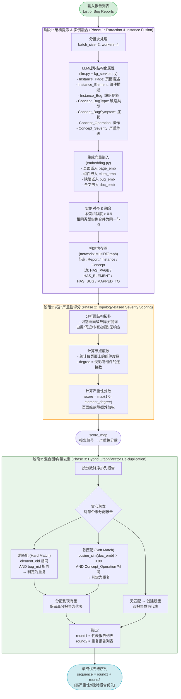
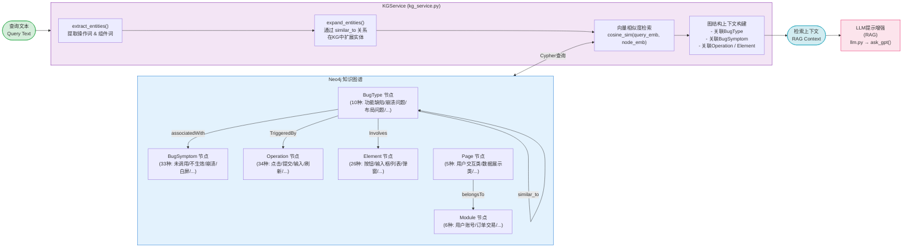
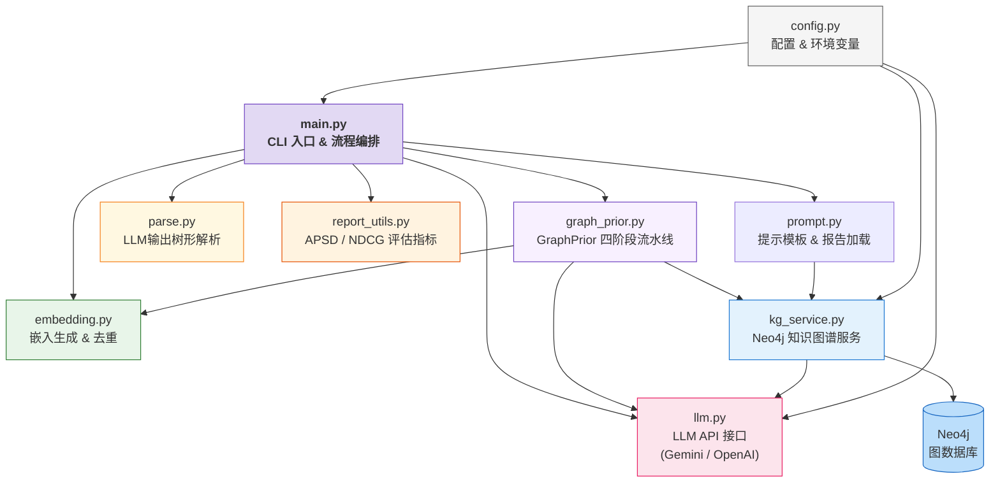
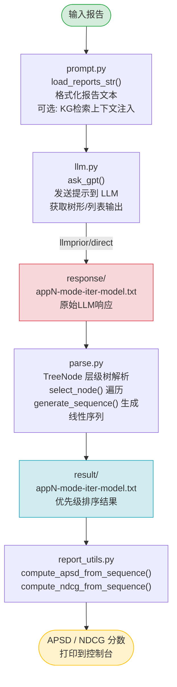
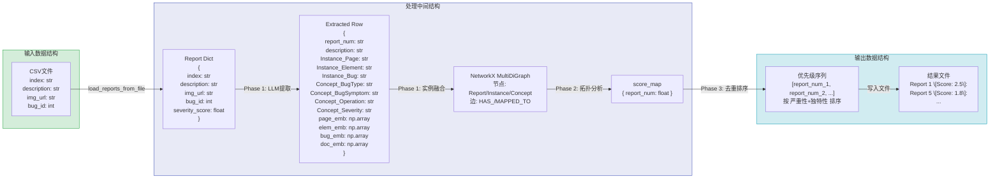

# GraphPrior 项目流程图 / Project Flowchart

## 1. 整体系统架构与数据流 / Overall System Architecture & Data Flow

```mermaid
flowchart TD
    A([📄 输入: Bug报告 CSV\nreports/appN.csv\n字段: index, description, img_url, bug_id]) --> B

    B{执行模式选择\n--mode}

    B -- graphprior --> C[GraphPrior 四阶段流水线\ngraph_prior.py]
    B -- llmprior --> D[LLM树形分类\nllm.py + parse.py]
    B -- direct --> E[LLM直接分类+排序\nllm.py + parse.py]
    B -- simple --> F[简化LLM提示\nllm.py + parse.py]
    B -- embedding --> G[嵌入相似度去重\nembedding.py]

    C --> H
    D --> H
    E --> H
    F --> H
    G --> H

    H([📊 输出: 优先级序列\nresult/appN-mode-iter-model.txt\n格式: Report 1 \[Score: 2.5\]\nReport 5 \[Score: 1.8\]\n...]) --> I

    I[评估阶段\nreport_utils.py]
    I --> J([📈 评估指标\nAPSD: 平均严重性分布百分比\nNDCG@10 / NDCG@20: 排序质量])

    style A fill:#d4edda,stroke:#28a745
    style H fill:#d1ecf1,stroke:#17a2b8
    style J fill:#fff3cd,stroke:#ffc107
    style C fill:#e2d9f3,stroke:#6f42c1
```

---

## 2. GraphPrior 四阶段核心流水线 / GraphPrior 4-Phase Core Pipeline



---

## 3. 知识图谱辅助检索流程 / Knowledge Graph Assisted Retrieval Flow



---

## 4. 模块依赖关系 / Module Dependency Graph



---

## 5. LLMPrior / Simple / Direct 模式流程 / Alternative Mode Flows



---

## 6. 数据结构流转 / Data Structure Flow


